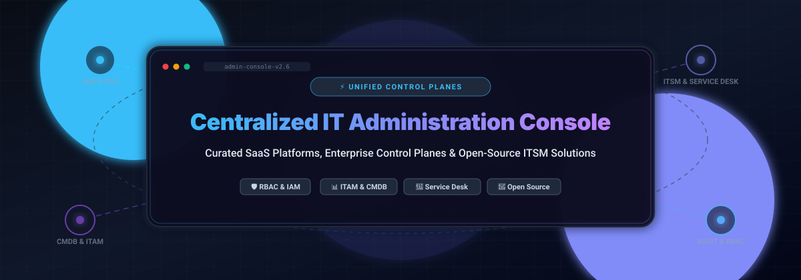

# 🛠️ Centralized IT Administration Console & Unified Control Planes

  

  <strong>A curated list of top SaaS platforms and open-source GitHub projects for Centralized IT Administration Consoles, Unified Service Management, Remote Monitoring &amp; Management (RMM), ITAM/CMDB, and Identity Control Planes.</strong>

---

## 📑 Table of Contents

- [🌐 Sector Overview & Market Dynamics](#-sector-overview--market-dynamics)
- [💼 Enterprise SaaS Platforms](#-enterprise-saas-platforms)
- [🚀 Open-Source GitHub Projects](#-open-source-github-projects)
- [💡 Architectural Blueprint & Best Practices](#-architectural-blueprint--best-practices)
- [🤝 How to Contribute](#-how-to-contribute)
- [💖 Support & Sponsorship](#-support--sponsorship)
- [📈 Star History](#-star-history)
- [⚖️ Disclaimer](#️-disclaimer)

---

## 🌐 Sector Overview & Market Dynamics

The global **IT Service Management (ITSM)** and **Centralized IT Administration Console** sector represents an estimated market size of **$14.8 billion to $17.4 billion in 2026**, expanding at a robust Compound Annual Growth Rate (CAGR) of 14.4% to 16.4% as modern enterprise infrastructure shifts toward unified, cloud-native control planes and agentic workflow orchestration. 

The sector is **moderately fragmented** rather than a winner-take-all monopoly: enterprise heavyweights (**ServiceNow**, **Salesforce**, and **Atlassian**) command massive footprints in complex cross-departmental operations and large-scale enterprises. Meanwhile, agile mid-market challengers (**Freshworks**, **Zoho**, **Zendesk**, and **SysAid**) aggressively secure market share by delivering lower total cost of ownership, rapid time-to-value, transparent pricing tiers, and specialized administration consoles. In parallel, self-hosted and open-source control planes (**NetBox**, **Snipe-IT**, **MeshCentral**, and **GLPI**) are surging among DevOps teams, platform engineers, and security-conscious organizations seeking vendor neutrality and air-gapped governance.

---

## 💼 Enterprise SaaS Platforms

| 🏢 Company Valuation / Revenue | 🖥️ Platform / Admin Console | 💳 Starting Pricing | 🎁 Free Tier / Trial Limits | ⚙️ Key Administrative & Centralized Control Features |
| :--- | :--- | :--- | :--- | :--- |
| **Salesforce** ~$185B Market Cap | [Salesforce Setup](https://help.salesforce.com/s/articleView?id=001787641&type=1) | $25/user/month (Starter Suite) | 30-day free trial (up to 10 users, 2,000 marketing emails, no credit card required) | Central administrative backend for org configurations, immutable Business Unit setup for Account Engagement, security profiles, permission sets, and cross-cloud governance. |
| **ServiceNow** ~$110B Market Cap | [ServiceNow Admin (Clone Admin Console)](https://www.servicenow.com/community/in-other-news/clone-admin-console-and-its-features/bc-p/3484786/highlight/true#M11080) | ~$70–$100/user/month (ITSM Foundation benchmark) | Free Personal Developer Instance (PDI) for learning/testing (non-production; hibernates when inactive; corporate trials via sales-guided PoC) | Centralized instance cloning administration with Clone Profiles, exclusion/preserver rules, script execution engines, role hierarchies, and enterprise CMDB administration. |
| **Atlassian** ~$43B Market Cap | [Jira Service Management Project Settings](https://confluence.atlassian.com/servicemanagementserver112/getting-started-for-service-project-admins-1688900495.html) | $21.50/agent/month (Standard tier) | Free forever plan for up to 3 agents (unlimited portal customers, 2 GB file storage, 1,250 automation executions/month, 1 site) | Service project admin console managing queue layouts, custom request types, SLA policies, portal branding, and unified customer authorization scopes. |
| **Zoho Corporation** ~$12B+ Valuation (Private, $1.4B+ Revenue) | [Zoho Desk Admin](https://www.zoho.com/sites/default/files/spark/productagendas/zoho-desk-admin-agenda-new.pdf) | $14/agent/month (Standard; or $7/agent/month for Express) | Free forever plan for up to 3 agents (includes 1 support email inbox, web forms, client portal, basic SLA escalation, and 2 macros) | Centralized control interface for multi-channel support routing, department access partitioning, custom field layouts, agent permissions, and support process flow automation. |
| **HubSpot** ~$10.5B Market Cap | [HubSpot Settings (User Presets)](https://knowledge.hubspot.com/zh-cn/user-management/manage-user-preferences-with-user-groups) | $15–$20/seat/month (Service Hub Starter) | Free forever CRM plan for up to 2 users (capped at 1,000 contacts, 1 shared inbox, 1 meeting link, basic ticketing, HubSpot-branded) | Super admin console for creating Presets to standardize user group defaults (homepage, dashboards, language, locale, signatures) alongside role-based data partitioning. |
| **Zendesk** ~$10.2B Acquisition Valuation ($2.0B ARR) | [Zendesk Admin Center](https://support.zendesk.com/hc/en-us/sections/9823649897882-Account-administration) | $19/agent/month (Support Team) or $55/agent/month (Suite Team) | 14-day free trial of Suite Professional (no credit card required; startups program offers 6 months free for up to 50 agents) | Unified management of global cross-product configurations, account ownership, audit logs, notification matrices, authentication rules, and configuration inspection. |
| **Freshworks** ~$3.4B Market Cap | [Freshworks Neo Admin Center](https://support.freshworks.com/support/solutions/articles/50000003135-how-to-access-freshdesk-with-freshworks-neo-admin-center) | $19/agent/month (Freshdesk Growth) | Free Program capped at 2 agents for 6 months (or 14-day full feature trial on paid tiers) | Single administrative control plane across Freshworks products with centralized security policies (SSO via SAML/OIDC/OAuth2/JWT, TOTP 2FA), audit logs, and account login policies. |
| **Ivanti** ~$1.7B–$2.0B Valuation ($500M+ Revenue) | [Ivanti Neurons Configuration Console](https://docs.ivanti.com/neurons-for-itsm/admin-user-help/enu/latest/about-the-configuration-console?x=2) | ~$80–$100/analyst/month (Public sector/G-Cloud benchmark) | No self-service free trial (evaluated via custom sales-guided demo or corporate Proof-of-Concept sandbox) | Dedicated admin console for configuring Ivanti Neurons ITSM modules, role access permissions, categorized system settings, business logic, and dashboard orchestration. |
| **Cherwell Software (Ivanti)** ~$170M Acquisition Valuation | [Cherwell CSM Administrator](https://www.cherwellsupport.com/WebHelp/en/4.60/5521.htm) | ~$105–$125/concurrent user/month (Benchmark; reaching EOL Dec 31, 2026) | No self-service free trial (legacy platform evaluated via sales migration demo / custom PoC sandbox) | Role-based desktop administrative console allowing administrators to configure database connections, security blueprints, business objects, and administrative roles. |
| **SysAid** ~$30M Funding ($20M–$35M Revenue) | [SysAid Admin](https://documentation.sysaid.com/docs/getting-started-guide) | $89/agent/month (Professional plan with AI features) | 30-day free trial (full product access, guided deployment, no credit card required) | Comprehensive administrator console for customizing self-service incident forms, end-user portal design, system-level integrations, and automated ticketing rules. |

---

## 🚀 Open-Source GitHub Projects

Curated self-hosted administrative control planes, open-source ITSM consoles, IT asset management (ITAM) platforms, and CMDB infrastructure. Repositories are ranked by GitHub Stars_Count in descending order.

1. **[NetBox](https://github.com/netbox-community/netbox)**   
   The premier open-source Network Infrastructure Source of Truth (NSoT) and data center infrastructure management (DCIM) console. Unifies IP address management (IPAM), rack units, cables, device inventory, virtualization, and network automation APIs into a centralized administrative plane.

2. **[Snipe-IT](https://github.com/snipe/snipe-it)**   
   Industry-standard open-source IT asset management (ITAM) administrative console built on Laravel. Features centralized administration for hardware inventory, software licenses, component tracking, user check-in/checkout, barcodes/QR codes, SAML/LDAP authentication, and auditable asset lifecycles.

3. **[MeshCentral](https://github.com/Ylianst/MeshCentral)**   
   Complete web-based remote computer and device management web console. Allows system administrators to manage, monitor, and remotely access Windows, Linux, and macOS endpoints behind NATs/firewalls with hardware KVM, terminal access, file transfer, and Intel AMT out-of-band management.

4. **[GLPI](https://github.com/glpi-project/glpi)**   
   Comprehensive open-source IT asset and service management suite with ITIL Service Desk, software auditing, license management, and CMDB impact analysis. Delivers a mature, self-hosted administrative hub covering helpdesk ticketing, contracts, and financial asset management.

5. **[Zammad](https://github.com/zammad/zammad)**   
   Modern web-based open-source customer support and ticketing system with a high-performance administration backend. Provides multi-channel management (email, chat, phone, social), granular role-based permissions, automated SLA rules, audit logging, and integrations with LDAP/Exchange.

6. **[Tactical RMM](https://github.com/amidaware/tacticalrmm)**   
   A remote monitoring and management (RMM) platform designed for MSPs and IT departments. Built with Django and Vue, it provides a centralized administration dashboard for automated script execution, patch management, real-time remote desktop, alerting, and automated client onboarding.

7. **[osTicket](https://github.com/osTicket/osTicket)**   
   Widely deployed open-source support ticket system featuring an administrative control panel for configuring routing rules, ticket assignment filters, department staff permissions, custom forms, and client self-service portals.

8. **[Trudesk](https://github.com/polonel/trudesk)**   
   Clean, modern open-source helpdesk solution built on Node.js and MongoDB. Includes a centralized administration panel for role-based access management, ticket routing workflows, live chat widgets, reports, and REST API configurations.

9. **[ITFlow](https://github.com/itflow-org/itflow)**   
   Open-source IT documentation, ticketing, and accounting platform for MSPs and internal IT departments. Provides a unified portal for credential vaults, client asset tracking, billing, vendor agreements, and network documentation.

10. **[Windshift](https://github.com/windshiftapp/core)**   
    Self-hosted work management and service management platform (Go binary) featuring Jira-style issue tracking, SLAs, customer portal, knowledge base, custom workflows, permissions, and built-in CMDB asset registers.

11. **[FreeITSM](https://github.com/edmozley/freeitsm)**   
    Self-hosted ITSM tool suite with customer self-service, task management, asset register with QR tags, checklists/SOPs, AI-assisted knowledge base, change management with CAB voting, and CMDB impact analysis.

12. **[ClientSt0r](https://github.com/agit8or1/clientst0r)**   
    Multi-tenant IT documentation and service management console for MSPs featuring client runbooks, encrypted credential vault, native ticketing with SLAs, and Entra ID / LDAP sign-in.

13. **[Atlas CMDB](https://github.com/mojoaar/atlascmdb)**   
    Next.js-powered open-source Configuration Management Database (CMDB) console with rack visualization, CI relationship graphs, OIDC SSO, SCIM 2.0 provisioning, TOTP MFA, and audit logging.

14. **[GOTRS Community Edition](https://github.com/gotrs-io/gotrs-ce)**   
    Enterprise service desk and ticketing engine (Go-based OTRS reimplementation) designed for air-gapped deployments, custom role hierarchies, REST API connectivity, and high-concurrency ticket management.

---

## 💡 Architectural Blueprint & Best Practices

When designing or deploying a centralized IT administration console:

- 🔐 **Zero-Trust & SSO Integration**: Require SAML 2.0 / OIDC authentication with mandatory MFA (FIDO2/WebAuthn or TOTP) across all admin panels.
- 👥 **Role-Based Access Control (RBAC)**: Enforce the principle of least privilege (PoLP) and segment super-admin rights from operational helpdesk staff.
- 📜 **Immutable Audit Logging**: Ensure administrative actions—such as privilege escalation, role modification, or data export—are piped to immutable SIEM tools.
- 🔄 **Configuration-as-Code (CaC)**: Leverage REST APIs or Terraform providers where possible to manage tenant configurations reproducibly.

---

## 🤝 How to Contribute

Contributions are welcome! To contribute:

1. 🍴 Fork this repository.
2. 🌿 Create a feature branch: `git checkout -b feature/add-new-console`.
3. 📝 Add your entry under the corresponding section following the standard format (include links, transparent pricing/free tiers, or repository Stars_Badges).
4. 🚀 Submit a Pull Request with a clear description of the console and its administrative capabilities.

---

## 💖 Support & Sponsorship

If this curated repository saved your team time or helped in your IT infrastructure evaluations, consider supporting the project:

- ⭐ **Star the repository** to boost visibility and help others discover it.
- 🍴 **Fork and contribute** your favorite open-source consoles and tools.
- 📢 **Share with peers** on LinkedIn, Reddit, or Twitter/X.
- ☕ **Buy a coffee & sponsor**: Support continuous maintenance and updates via the [GitHub Sponsor Dashboard](https://github.com/sponsors/ishandutta2007).

---

## 📈 Star History

---

## ⚖️ Disclaimer

- This list is **community-curated** for educational, engineering, and informational purposes. It does not constitute an official commercial endorsement.
- Centralized IT administration platforms hold root-level access and sensitive telemetry. Always verify network segmentation, backup strategies, and vulnerability patching schedules before deploying into production environments.
